  

  
  

 

### Featured projects

<table>
  <tr>
    <td width="50%" valign="top">
      <h4><a href="https://github.com/burakaydins/iospath">iospath</a></h4>
      
A learning roadmap for aspiring iOS developers: track progress, prepare for interviews, build a portfolio. <a href="https://burakaydins.github.io/iospath/">Live demo</a>

      
      
    </td>
    <td width="50%" valign="top">
      <h4><a href="https://github.com/burakaydins/melodikit">melodikit</a></h4>
      
A Spring Boot web app for managing songs, genres, and playlists with Thymeleaf, Spring MVC, and an H2 database.

      
      
    </td>
  </tr>
  <tr>
    <td colspan="2" valign="top">
      <h4>Tavşan Niyeti</h4>
      
    </td>
  </tr>
</table>

 

### Tech stack

  

<table>
  <tr>
    <td width="160"><b>Languages</b></td>
    <td>
      
    </td>
  </tr>
  <tr>
    <td width="160"><b>UI</b></td>
    <td>
      
      
      
      
    </td>
  </tr>
  <tr>
    <td width="160"><b>Architecture</b></td>
    <td>
      
      
      
      
      
      
      
    </td>
  </tr>
  <tr>
    <td width="160"><b>Data</b></td>
    <td>
      
      
      
      
      
    </td>
  </tr>
  <tr>
    <td width="160"><b>Networking</b></td>
    <td>
      
      
      
    </td>
  </tr>
  <tr>
    <td width="160"><b>Apple frameworks</b></td>
    <td>
      
      
      
      
      
    </td>
  </tr>
  <tr>
    <td width="160"><b>Quality</b></td>
    <td>
      
      
      
    </td>
  </tr>
  <tr>
    <td width="160"><b>Tools</b></td>
    <td>
      
      
      
      
      
      
    </td>
  </tr>
  <tr>
    <td width="160"><b>Backend &amp; web</b></td>
    <td>
      
      
      
      
      
      
      
      
    </td>
  </tr>
</table>
